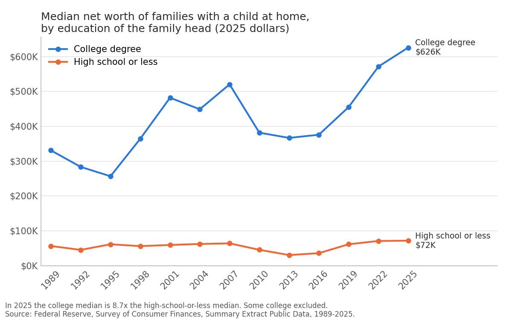

# Wealth gap by parents' education, US, 1989–2025

**Reproduces:** the POLISCI 158 Section 3 lab's demo figure (assignment Option B),
wealth by parents' education, from the Federal Reserve's Survey of Consumer
Finances, extended to the latest survey (2025).



**The figure:** median net worth of US families with a child at home, comparing
families whose head has a college degree with families whose head has a high
school education or less, for every Survey of Consumer Finances from 1989 to
2025, in 2025 dollars.

In 2025 the median was $626K for college-educated families and $72K for
high-school-or-less families, a ratio of 8.7× (95% confidence interval 6.0× to
11.5×). In 1989 it was 5.9×. The widest gap was 12.0×, in 2013.

## Data

Federal Reserve Board, [Survey of Consumer Finances](https://www.federalreserve.gov/econres/scfindex.htm),
Summary Extract Public Data, one CSV file per survey:
`https://www.federalreserve.gov/econres/files/scfp{YEAR}excel.zip`.
The 13 surveys run every three years from 1989 to 2025. The 2025 survey, released
October 9, 2026, is the latest.

## Choices behind the numbers

- **Dollars:** the Fed publishes every survey's file already adjusted to 2025
  dollars (CPI-U-RS). The scripts adjust nothing further.
- **Families:** only families with at least one of the head's children living at
  home (`KIDS > 0`, children of any age).
- **Whose education:** the family head's (`EDCL`). "College degree" means a
  bachelor's or more; "high school or less" includes no diploma. Some college is
  left out of both groups. The education of the head's own parents is only asked
  from 2016 on, so it can't cover 1989–2025.
- **Statistic:** the median, which describes a typical family. A few very wealthy
  families pull the mean far higher: $2.29M vs. $269K in 2025, a ratio of 8.5×
  (`python plot.py --stat mean`).
- **Weights:** each family appears five times, once per imputed version. All five
  rows are kept and weighted by `WGT`.

## Checks (`validate.py`)

- **The Fed's own tables:** our medians match all 65 numbers in the Fed's
  published Table 4 to within $5. That covers 1989–2025, by head's education and
  for families with children. The Fed doesn't publish education and children
  together, so each half is checked separately.
- **Margin of error:** uses the Fed's replicate weights. The method reproduces the
  Fed's published standard errors ($6.6K vs. $6.4K for all families; $33.0K vs.
  $33.1K for college-degree families).
- **Another source:** the Census Bureau's SIPP survey (2024) has a similar overall
  median ($205K vs. $216K) but lower medians by education. It groups households by
  the highest education of anyone in them, and it measures wealth less thoroughly
  than the SCF.

## How close, and what next

- **How close:** the lab's dry run reported that, for families with a child at
  home, the 2025 gap is about as wide as in 2013. The mean version here agrees
  (8.5× in 2025 vs. 8.6× in 2013). The median version shows a narrower 2025 gap
  than 2013 (8.7× vs. 12.0×).
- **Next:** add a 95% interval to every year, not just 2025; restrict to heads
  aged 25–54, since the two groups differ in age and marriage rates; and use the
  head's own parents' education, which the SCF's full dataset has for 2016–2025.

## Rerun

Requires Python 3.9 or later.

```bash
python3 -m venv venv
source venv/bin/activate
pip install pandas numpy matplotlib requests openpyxl
python get_data.py          # downloads the 13 survey files into data/ (~350 MB)
python plot.py              # writes wealth_gap_by_education.png and .csv
python plot.py --stat mean  # optional: the same figure with the mean
python validate.py          # optional: checks against the Fed's tables (~30 MB download, ~70 MB on disk)
```

`data/` is not committed to git; `get_data.py` recreates it.
